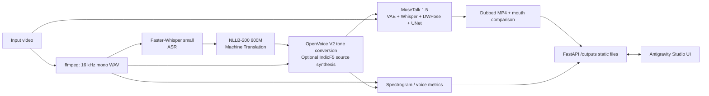

# NeuralDub Studio

NeuralDub Studio is an end-to-end multilingual video dubbing and lip-sync engine. It translates a talking-head video, preserves the reference speaker's vocal character, and renders audio-driven lip motion for the translated speech.

The project is designed around an 8 GB Apple M1 MacBook Air for local demonstration, with a Google Colab Pro GPU workflow for fine-tuning MuseTalk.



## Features

- Faster-Whisper transcription with segment timings.
- NLLB-200 translation for English, Hindi, Kannada, and Spanish.
- OpenVoice V2 speaker-tone conversion; optional IndicF5 support for Indian languages.
- MuseTalk 1.5 latent-space lip-sync with optional fine-tuned UNet weights.
- High-contrast Mel-spectrogram, pitch/energy, and lip-sync timeline telemetry.
- Background FastAPI jobs with frontend-friendly status and artifact URLs.
- Colab Pro fine-tuning notebook with a reproducible multi-term objective and quantitative evaluation workflow.

See [the architecture note](docs/NNDL_ARCHITECTURE.md) for equations, metrics, model boundaries, and memory engineering.

## Prerequisites

- Python 3.10 or newer.
- `ffmpeg` available on `PATH`.
- Git (needed when MuseTalk is first fetched).
- For local inference: Apple Silicon/MPS, CUDA, or CPU. CUDA is strongly recommended for MuseTalk.
- Sufficient disk space for model checkpoints. Downloading models requires internet on first use.

The inference pipeline has been structured for an 8 GB M1, but MuseTalk rendering can still be slow and memory-sensitive. Close memory-heavy apps and process one request at a time.

## Local setup

```bash
git clone <your-repository-url> neural-dub-studio
cd neural-dub-studio
python3 -m venv venv
source venv/bin/activate
pip install --upgrade pip
pip install -r requirements.txt
```

Install `ffmpeg` on macOS, for example:

```bash
brew install ffmpeg
```

OpenVoice and MuseTalk download their checkpoints lazily into `models/` the first time a relevant stage runs. Do not commit `models/` or `outputs/`.

## Run a local demo

Part 1 validates extraction, ASR, translation, cloning, and spectrogram telemetry:

```bash
source venv/bin/activate
python test_part1.py --video assets/sample.mp4 --lang hin_Deva
```

Part 2 runs the complete four-stage pipeline, including lip-sync:

```bash
python test_part2.py --video assets/sample.mp4 --lang hin_Deva
```

Artifacts are written beneath `outputs/`. A complete run produces a cloned audio WAV, a spectrogram PNG, dubbed MP4, and a mouth-comparison MP4.

### Optional IndicF5

For Hindi or Kannada, IndicF5 is an opt-in source synthesizer before OpenVoice conversion. It can use substantial RAM and may require checkpoint downloads, so it is disabled by default:

```bash
export NEURALDUB_USE_INDIC_F5=1
python test_part1.py --video assets/sample.mp4 --lang kan_Knda
```

If IndicF5 is unavailable, has no cached checkpoint, or fails, the pipeline uses Edge TTS followed by OpenVoice V2 rather than failing the job.

## Start the API for Antigravity Studio

```bash
source venv/bin/activate
uvicorn backend.server:app --host 0.0.0.0 --port 8000 --reload
```

The visual frontend can use these endpoints:

| Endpoint | Purpose |
| --- | --- |
| `GET /api/health` | Device, available RAM, and fine-tuned-checkpoint availability. |
| `POST /api/dub` | Multipart form: `video_file`, `target_language`, `use_finetuned_weights`. Returns a `job_id`. |
| `GET /api/status/{job_id}` | Progress, RAM, completion/error state, and result URLs. |
| `GET /api/training-metrics` | Training curves and benchmark JSON, or chart-safe pre-training placeholders. |
| `GET /outputs/...` | Generated MP4/WAV/PNG artifacts. |

Example request:

```bash
curl -X POST http://localhost:8000/api/dub \
  -F video_file=@assets/sample.mp4 \
  -F target_language=hin_Deva \
  -F use_finetuned_weights=true
```

Poll the returned ID at `/api/status/<job_id>`. Each job stores its own artifacts below `outputs/<job_id>/`; this prevents simultaneous jobs from overwriting each other.

## Fine-tune on Google Colab Pro

1. Use a T4, L4, or A100 GPU runtime in Colab.
2. Upload or open [`training/FineTune_MuseTalk.ipynb`](training/FineTune_MuseTalk.ipynb).
3. Copy [`training/evaluate_metrics.py`](training/evaluate_metrics.py) into `/content/neural-dub-studio/`, or clone this repository into that path.
4. Run Cell 1 to install MuseTalk, evaluation dependencies, and download weights.
5. Run Cell 2. It downloads a public talking-head sample for smoke testing; upload only licensed, consented clips for HDTF/MEAD/LRS2-scale training or a custom identity adaptation clip.
6. Configure a real pretrained SyncNet checkpoint before the full-loss experiment. A no-SyncNet run is an explicit ablation, not the reported full model.
7. Run Cells 3–4 for selective fine-tuning, held-out baseline comparison, and ablations.
8. Run Cell 5 to download `neural_dub_artifacts.zip` and back it up to Google Drive.
9. Copy `unet_finetuned.pth` and `training_metrics.json` from the archive into local `models/`.

The server detects `models/unet_finetuned.pth` and uses it when `use_finetuned_weights=true`.

## Repository layout

```text
backend/
  audio_pipeline.py       ASR, translation, and voice cloning
  lipsync_engine.py       MuseTalk bootstrap/inference and mouth telemetry
  memory_utils.py         Device selection and cache flushing
  server.py               FastAPI contract for the visual frontend
  visual_telemetry.py     Spectrogram and voice-similarity metrics
training/
  FineTune_MuseTalk.ipynb        Colab Pro training/evaluation workflow
  evaluate_metrics.py             Standalone SSIM/PSNR/SyncNet evaluator
models/                  Downloaded checkpoints and fine-tuned artifacts (ignored)
outputs/                 Generated artifacts (ignored)
docs/NNDL_ARCHITECTURE.md
```

## Responsible use

Only dub media that you own or are authorized to process, and obtain explicit consent before cloning a person's voice or likeness. Keep source videos and generated speech secure, especially when working with identifying audio.
