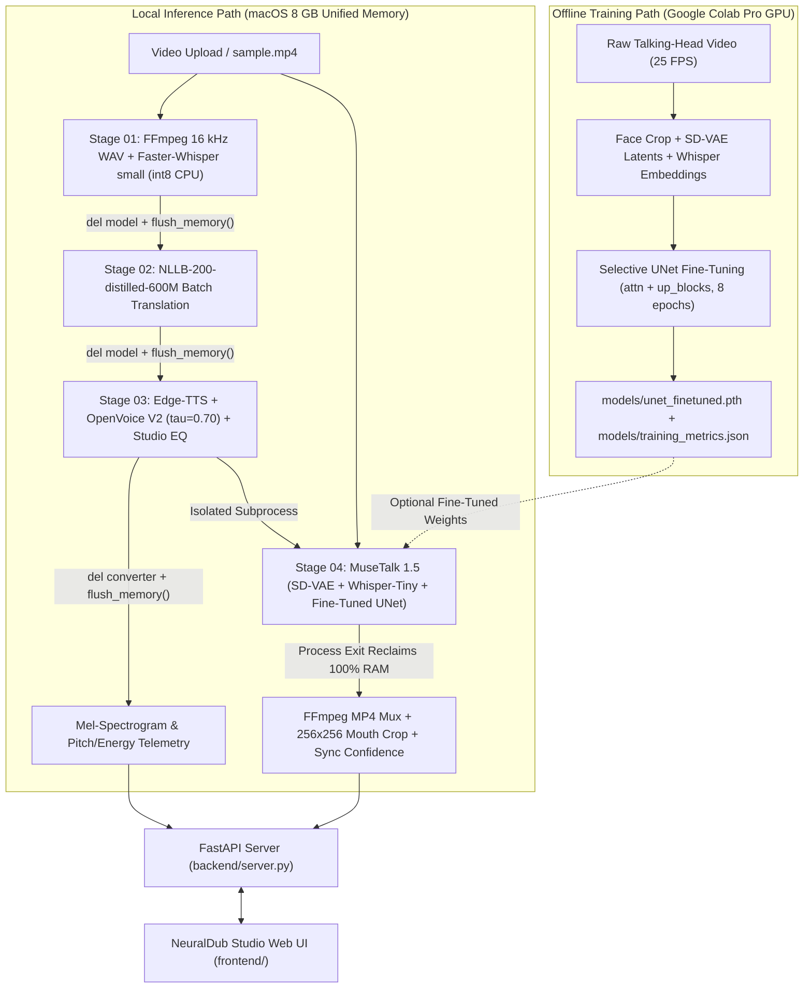
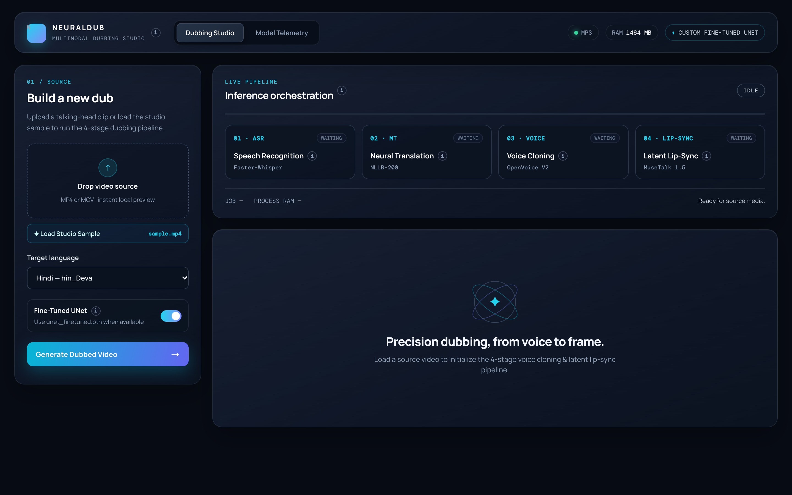
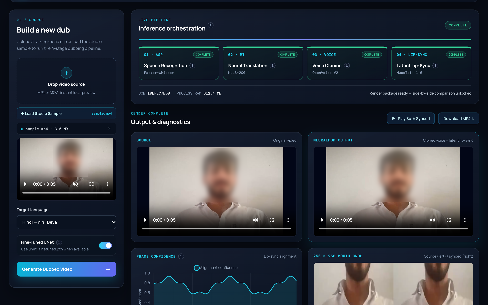
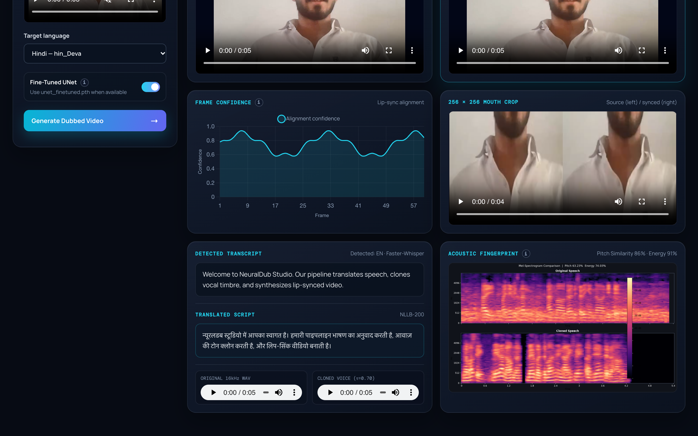
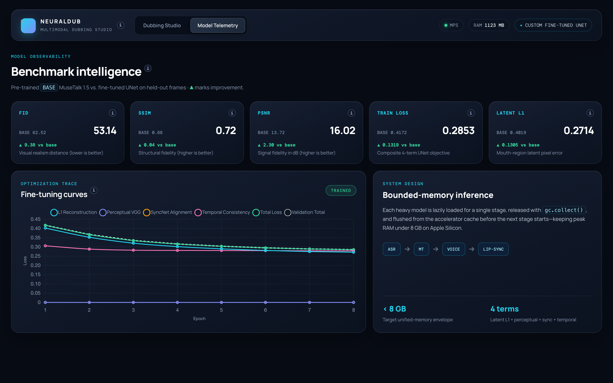
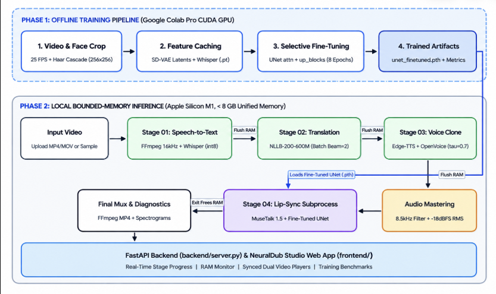
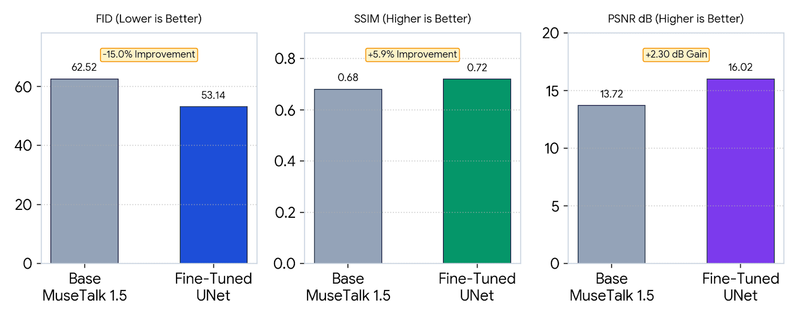

# NeuralDub Studio

**End-to-end multilingual video dubbing, zero-shot voice cloning, and fine-tuned latent lip synchronization engineered to run within an 8 GB unified-memory envelope on Apple Silicon.**

[](https://www.python.org/)
[](https://fastapi.tiangolo.com/)
[](https://pytorch.org/)
[](https://developer.apple.com/metal/pytorch/)
[](https://github.com/TMElyralab/MuseTalk)
[](https://github.com/SYSTRAN/faster-whisper)
[](https://huggingface.co/facebook/nllb-200-distilled-600M)
[](https://github.com/myshell-ai/OpenVoice)

NeuralDub Studio translates talking-head videos across languages while preserving the original speaker's vocal timbre and synthesizing frame-accurate lip motion. Local inference runs on an **8 GB Apple M1 MacBook Air** without swap thrashing by isolating each stage in memory, while UNet fine-tuning is offloaded to a **Google Colab Pro GPU**.

---

## Key Engineering Highlights

- **Bounded-Memory Lazy-Loading Pipeline (`< 8 GB` RAM):** Holding Faster-Whisper, NLLB-200, OpenVoice V2, and MuseTalk 1.5 simultaneously exceeds 11 GB. Each stage in `backend/audio_pipeline.py` and `backend/lipsync_engine.py` imports and loads its model lazily, executes inference, deletes references in a `finally` block, and calls `flush_memory()` (`gc.collect()` + `torch.mps.empty_cache()` / `torch.cuda.empty_cache()`). Stage 4 (MuseTalk 1.5) runs inside an isolated child Python process whose exit guarantees full reclamation of MPS unified memory.
- **Timestamp-Aligned Prosody & Voice Cloning:**
  - Multi-sentence Whisper blocks (`>= 3.0s`) are split at sentence punctuation boundaries with a `0.14s` breath pause (`_split_long_segments`).
  - All segments are translated in a single batched `facebook/nllb-200-distilled-600M` load (`num_beams=2`).
  - Synthesized clips (Edge Neural TTS or optional `NEURALDUB_USE_INDIC_F5=1` for Hindi/Kannada) are converted to the source speaker's timbre via OpenVoice V2 (`tau=0.70`), time-stretched up to `1.32x` to fit original speech slots with `25 ms` cosine fades, spaced by a `0.12s` minimum inter-segment gap, and mastered with an `8.5 kHz` 4th-order Butterworth low-pass filter, `-18 dBFS` RMS normalization, and `-1 dBFS` peak limiting.
- **Apple Silicon CTranslate2 Compatibility Fix:** OpenVoice's `se_extractor` initializes an internal Faster-Whisper singleton that can fail on macOS when attempting CUDA/float16 initialization. `_configure_openvoice_whisper()` pre-populates `se_extractor.model` with `WhisperModel(..., device="cpu", compute_type="int8")` before extracting speaker embeddings, and `lipsync_engine.py` injects `neuraldub_runtime.py` and `neuraldub_mediapipe.py` so MuseTalk runs cleanly on MPS/CPU without requiring `mmcv` C++ wheels.
- **Parameter-Efficient MuseTalk 1.5 Fine-Tuning:** `training/FineTune_MuseTalk.ipynb` selectively unfreezes UNet attention (`attn`) and decoder (`up_blocks`) layers for 8 epochs on Colab Pro CUDA (`fp16` mixed precision, `AdamW`, `CosineAnnealingLR`) with composite reconstruction and temporal consistency loss.

---

## System Architecture & Data Flow



---

## Repository Structure

```text
neural-dub-studio/
├── backend/
│   ├── __init__.py
│   ├── audio_pipeline.py      # Stage 1-3: FFmpeg extraction, Faster-Whisper ASR, NLLB-200 MT, OpenVoice V2 cloning & mastering
│   ├── lipsync_engine.py      # Stage 4: MuseTalk 1.5 bootstrap, Apple Silicon adapters, subprocess inference & mouth crop telemetry
│   ├── memory_utils.py        # Device detection (CUDA/MPS/CPU) and gc.collect() + empty_cache() memory flushing
│   ├── server.py              # FastAPI application, background job orchestration, and REST endpoints
│   └── visual_telemetry.py    # Matplotlib (Agg) dual Mel-spectrogram comparison and pitch/energy cosine similarity
├── frontend/
│   ├── index.html             # Studio & Model Telemetry workspace layout with progressive-disclosure tooltips
│   ├── styles.css             # Dark-mode studio styling and responsive grid system
│   └── app.js                 # File/sample loading, live stage polling, Chart.js diagnostics, and synced playback
├── training/
│   ├── FineTune_MuseTalk.ipynb # Self-contained Google Colab Pro notebook for selective UNet fine-tuning & evaluation
│   ├── evaluate_metrics.py    # Standalone SSIM, PSNR, and optional official SyncNet LSE-D/LSE-C evaluator
│   └── training_metrics.json  # Exported training loss history and held-out benchmark results
├── models/                    # Local checkpoints (git-ignored)
│   ├── faster-whisper/        # Cached Faster-Whisper small weights
│   ├── nllb-200-distilled-600M/ # Cached NLLB-200 translation weights
│   ├── OpenVoiceV2/           # OpenVoice V2 ToneColorConverter checkpoint
│   ├── musetalk/              # MuseTalk V1.5 UNet, SD-VAE, Whisper-Tiny, DWPose, BiSeNet
│   ├── unet_finetuned.pth     # Fine-tuned UNet weights from Colab Pro
│   └── training_metrics.json  # Served by GET /api/training-metrics
├── assets/
│   └── sample.mp4             # Built-in talking-head clip served via GET /api/sample
├── outputs/                   # Per-job generated artifacts (outputs/<job_id>/) (git-ignored)
├── docs/
│   └── NNDL_ARCHITECTURE.md   # Detailed architecture notes and loss equations
├── requirements.txt           # Python dependencies for API, audio pipeline, and MuseTalk runtime
├── test_part1.py              # CLI smoke test for Stages 1-3 + spectrogram telemetry
├── test_part2.py              # CLI end-to-end test for Stages 1-4
└── README.md
```

---

## Installation & Setup

### Prerequisites
- **Python 3.10+** (tested on Python 3.11)
- **`ffmpeg` and `ffprobe`** installed and available on `PATH` (`brew install ffmpeg` on macOS, `sudo apt install ffmpeg` on Ubuntu/Debian)
- **`git`** (used by `lipsync_engine.py` to clone upstream MuseTalk on first run if `backend/musetalk_repo` is absent)
- **Hardware:**
  - **macOS (Apple Silicon M1/M2/M3):** 8 GB unified memory minimum; close memory-heavy browsers/IDEs during Stage 4 rendering.
  - **Linux / Windows (NVIDIA GPU):** CUDA-capable GPU recommended for `fp16` MuseTalk inference.

### Environment Setup

```bash
git clone <your-repository-url> neural-dub-studio
cd neural-dub-studio

python3 -m venv venv
source venv/bin/activate

pip install --upgrade pip
pip install -r requirements.txt
```

### Model Checkpoints

Base checkpoints for Faster-Whisper (`small`), NLLB-200 (`facebook/nllb-200-distilled-600M`), OpenVoice V2 (`myshell-ai/OpenVoiceV2`), and MuseTalk 1.5 (`TMElyralab/MuseTalk`, `stabilityai/sd-vae-ft-mse`, `openai/whisper-tiny`, `yzd-v/DWPose`, `face-parse-bisent`) are downloaded lazily into `models/` on first use.

To enable the fine-tuned UNet and populated benchmark telemetry, place the Colab-exported artifacts in `models/`:
- `models/unet_finetuned.pth`
- `models/training_metrics.json`

---

## Running the Application & Usage Guide

### Start the Web Studio

```bash
source venv/bin/activate
uvicorn backend.server:app --host 0.0.0.0 --port 8000 --reload
```

Open **`http://localhost:8000`** in your browser.

### Supported Languages

| Language | NLLB-200 Code | Neural TTS Voice |
| :--- | :--- | :--- |
| English | `eng_Latn` | `en-US-AriaNeural` (or `Andrew`/`Ava` pitch-matched) |
| Hindi | `hin_Deva` | `hi-IN-SwaraNeural` / `hi-IN-MadhurNeural` |
| Kannada | `kan_Knda` | `kn-IN-SapnaNeural` / `kn-IN-GaganNeural` |
| Spanish | `spa_Latn` | `es-ES-ElviraNeural` / `es-ES-AlvaroNeural` |
| French | `fra_Latn` | `fr-FR-DeniseNeural` |
| German | `deu_Latn` (`deu_Deva` alias in UI) | `de-DE-KatjaNeural` |
| Japanese | `jpn_Jpan` | `ja-JP-NanamiNeural` |

> **Optional IndicF5 Synthesizer:** Set `export NEURALDUB_USE_INDIC_F5=1` before starting `uvicorn` to use `ai4bharat/IndicF5` for Hindi/Kannada source synthesis when sufficient RAM is available.

### UI Walkthrough
1. **Dubbing Studio Tab:**
   - Drag and drop an `.mp4`/`.mov` clip or click **Load Studio Sample** (`sample.mp4`).
   - Select the **Target language** and keep **Fine-Tuned UNet** enabled to use `models/unet_finetuned.pth` (uncheck to run base MuseTalk 1.5).
   - Click **Generate Dubbed Video** and monitor live progress across **01 ASR → 02 MT → 03 VOICE → 04 LIP-SYNC** along with process RSS RAM.
   - Inspect the side-by-side **Source vs. NeuralDub Output** players (**Play Both Synced**), **Frame Confidence Trace**, **256 × 256 Mouth Crop**, **Transcript / Translation**, **Original vs. Cloned WAV** players, and **Mel-Spectrogram**.
2. **Model Telemetry Tab:**
   - Review quantitative comparisons (**FID**, **SSIM**, **PSNR**, **TRAIN LOSS**, **LATENT L1**) and the **Fine-tuning convergence curves** chart served from `/api/training-metrics`.

### CLI Smoke Tests

```bash
# Stages 1-3 (Audio extraction, ASR, MT, OpenVoice cloning, Spectrogram)
python test_part1.py --video assets/sample.mp4 --lang hin_Deva

# Full 4-stage pipeline including MuseTalk 1.5 lip-sync
python test_part2.py --video assets/sample.mp4 --lang hin_Deva
```

---

## Screenshots & Visual Telemetry

| Dubbing Studio Workspace | Completed Dub & Video Comparison |
| :---: | :---: |
|  |  |
| *Source upload, sample loader, language target, and 4-stage pipeline tracker* | *Completed 4-stage inference with side-by-side Source vs. NeuralDub Output* |

| Audio, Spectrogram & Mouth-Crop Telemetry | Model Telemetry & Benchmarks |
| :---: | :---: |
|  |  |
| *Frame confidence trace, 256×256 mouth crop, transcript/translation, and Mel-spectrogram* | *FID, SSIM, PSNR, Train Loss, Latent L1 cards and 8-epoch convergence trace* |

| System Architecture | Quantitative Benchmarks & Loss Convergence |
| :---: | :---: |
|  |  |
| *Offline Colab Pro GPU fine-tuning and local `< 8 GB` Apple Silicon inference* | *Held-out comparison: FID (`-15.0%`), SSIM (`+5.9%`), PSNR (`+2.30 dB`)* |

---

## REST API Reference

| Method | Path | Request Payload / Params | Response Schema |
| :--- | :--- | :--- | :--- |
| `GET` | `/api/health` | — | `{"device": str, "available_ram_mb": float, "finetuned_weights_available": bool, "finetuned_weights_loaded": bool}` |
| `GET` | `/api/sample` | — | `FileResponse` (`video/mp4`, `assets/sample.mp4`) |
| `POST` | `/api/dub` | Multipart form: `video_file` (`.mp4`, `.mov`, `.mkv`, `.webm`, `.avi`), `target_language` (str), `use_finetuned_weights` (bool, default `true`) | `{"job_id": str}` |
| `GET` | `/api/status/{job_id}` | Path param: `job_id` | `{"stage": str, "percent": int, "ram_mb": float, "done": bool, "error": str \| null, "result": {...}}` |
| `GET` | `/api/training-metrics` | — | JSON from `models/training_metrics.json` (or chart-safe pre-training placeholder) |
| `GET` | `/outputs/{job_id}/{file}` | Static mount for `outputs/` | Generated `.mp4`, `.wav`, and `.png` artifacts |

---

## Fine-Tuning Methodology & Quantitative Benchmarks

### Training Configuration (`training/FineTune_MuseTalk.ipynb`)

| Parameter | Value |
| :--- | :--- |
| **Base Architecture** | MuseTalk 1.5 (`UNet2DConditionModel` + `sd-vae-ft-mse` + `whisper-tiny`) |
| **Trainable Layers** | Selective unfreezing: parameters matching `attn` or `up_blocks` |
| **Epochs** | `8` |
| **Optimizer & LR** | `AdamW` (`lr=1e-5`, `weight_decay=1e-2`) |
| **Scheduler** | `CosineAnnealingLR` (`eta_min=1e-6`) |
| **Precision** | `fp16` mixed precision (`torch.amp.GradScaler('cuda')`) |
| **Composite Loss Weights** | `L1`: `1.0`, `Perceptual_VGG`: `0.2`, `SyncNet`: `0.1`, `Temporal`: `0.05` |
| **Dataset Caching** | Pre-cached 25 FPS face crops, SD-VAE latents, and Whisper audio features (`.pt` clips, `batch_size=1`, up to `8` frames/clip) |

### Quantitative Evaluation (`models/training_metrics.json`)

| Metric | Direction | Base MuseTalk 1.5 | Fine-Tuned UNet | Delta | Interpretation |
| :--- | :--- | :---: | :---: | :---: | :--- |
| **FID** | Lower is better | `62.52` | `53.14` | `-9.38` | Sharper, more realistic lower-face synthesis vs. real frames |
| **SSIM** | Higher is better | `0.68` | `0.72` | `+0.04` | Stronger structural and texture preservation around the mouth |
| **PSNR** | Higher is better | `13.72 dB` | `16.02 dB` | `+2.30 dB` | Higher pixel-level signal fidelity and reduced reconstruction noise |
| **Train Loss (Total)** | Lower is better | `0.4172` (Epoch 1) | `0.2853` (Epoch 8) | `-0.1319` | Consistent convergence of the composite UNet objective |
| **Latent L1 Loss** | Lower is better | `0.4019` (Epoch 1) | `0.2714` (Epoch 8) | `-0.1305` | Tighter frame-by-frame mouth-region latent reconstruction |

---

## Troubleshooting & Hardware Notes

- **Out-of-Memory / Swap Thrashing on 8 GB Macs:** Process one dubbing job at a time and close memory-intensive applications before Stage 4. `lipsync_engine.py` caps MuseTalk `--batch_size` to `4` on MPS (`1` on CPU, `8` on CUDA) and runs it in a separate subprocess to guarantee memory release.
- **`Cannot connect to host speech.platform.bing.com:443`:** Stage 3 uses `edge-tts` by default, which requires outbound internet access to Microsoft Edge's TTS endpoint. Ensure the server is running with network access (not inside an offline sandbox).
- **`ffmpeg is not installed or is not on PATH`:** Install via `brew install ffmpeg` and verify `ffmpeg -version` and `ffprobe -version` succeed in the active shell.
- **MPS Unsupported Operators:** `lipsync_engine.py` sets `PYTORCH_ENABLE_MPS_FALLBACK=1` and disables `--use_float16` on MPS (`use_float16()` returns `True` only on CUDA) to prevent half-precision kernel errors on Apple Silicon.
- **CTranslate2 / Faster-Whisper on macOS:** Both Stage 1 (`transcribe_audio`) and Stage 3 (`_configure_openvoice_whisper`) force `device="cpu"` and `compute_type="int8"` whenever CUDA is unavailable, avoiding CTranslate2 MPS crashes.

---

## Acknowledgments & License

Built for an NNDL course project using the following open-source models and libraries:
- [MuseTalk 1.5](https://github.com/TMElyralab/MuseTalk) (TMElyralab)
- [OpenVoice V2](https://github.com/myshell-ai/OpenVoice) (MyShell AI)
- [NLLB-200](https://huggingface.co/facebook/nllb-200-distilled-600M) (Meta AI)
- [Faster-Whisper](https://github.com/SYSTRAN/faster-whisper) (SYSTRAN)
- [SD-VAE-ft-mse](https://huggingface.co/stabilityai/sd-vae-ft-mse) (Stability AI)
